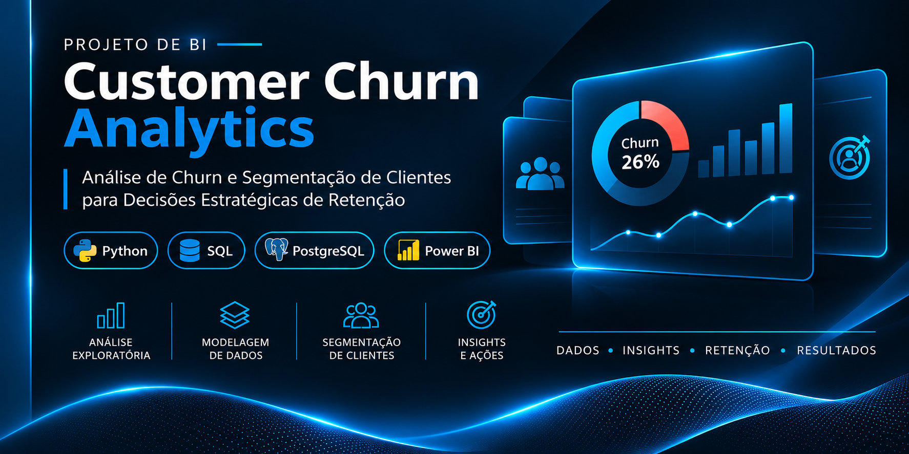
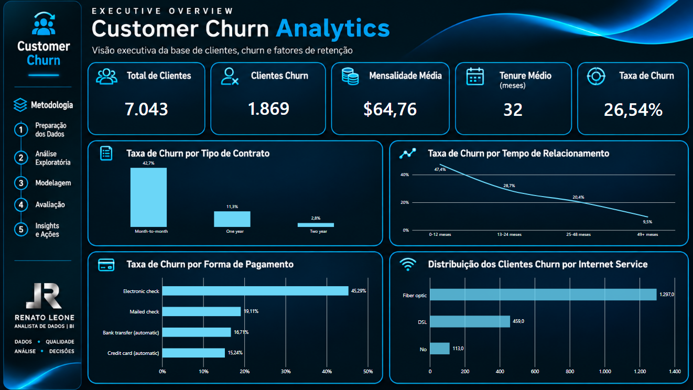
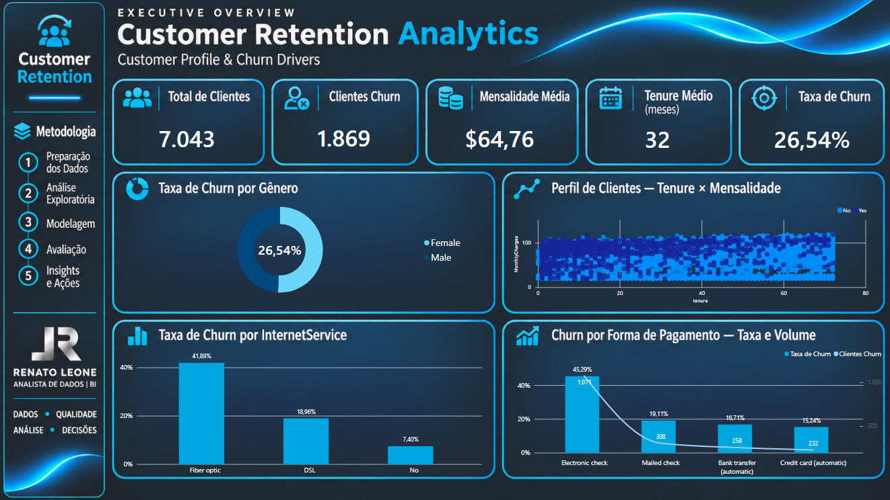
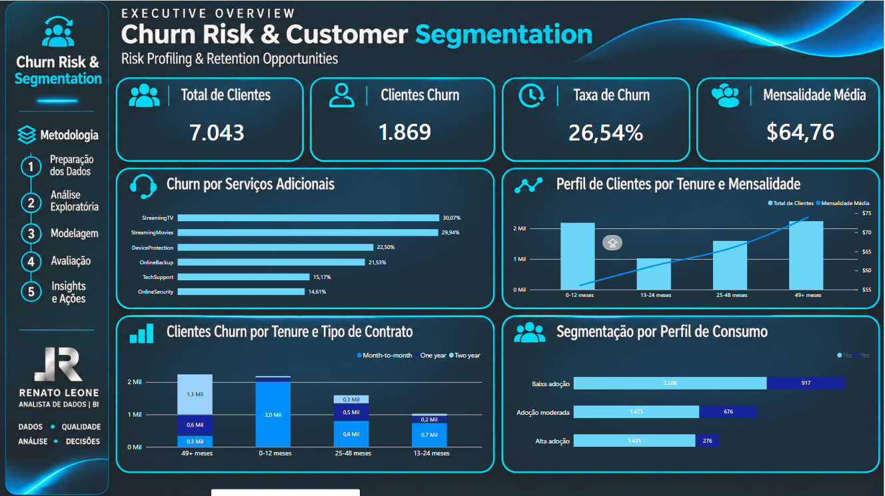
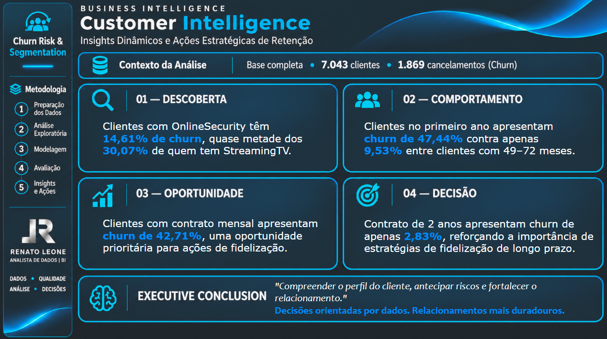

<div align="center">

# CUSTOMER CHURN ANALYTICS

### Customer Intelligence · Churn Risk · Customer Segmentation


**Análise de churn e segmentação de clientes para apoiar decisões estratégicas de retenção.**

</div>

---

## Visão geral do projeto



O **Customer Churn Analytics** é um projeto de análise de dados desenvolvido com o objetivo de compreender o comportamento de cancelamento de clientes (*customer churn*), investigar características associadas à saída de clientes e identificar segmentos relevantes para estratégias de retenção.

O projeto reúne preparação e qualidade dos dados, análise exploratória, engenharia de atributos, modelagem, avaliação e visualização de indicadores em dashboards desenvolvidos no Power BI.

## Dashboards

### 01 · Executive Overview

Visão executiva da base de clientes, dos cancelamentos e de indicadores relacionados à retenção.



### 02 · Customer Retention Analytics

Análise do perfil dos clientes e de dimensões associadas ao churn, incluindo gênero, tempo de relacionamento, serviço de internet e forma de pagamento.



### 03 · Churn Risk & Customer Segmentation

Análise de churn por serviços adicionais, tempo de relacionamento, tipo de contrato e perfil de adoção de serviços.



### 04 · Customer Intelligence

Síntese das descobertas analíticas e oportunidades de ação relacionadas à retenção de clientes.



## Problema de negócio e objetivos

A perda de clientes pode comprometer a receita e aumentar a necessidade de aquisição de novos consumidores. Compreender os perfis e comportamentos associados ao cancelamento ajuda a direcionar análises e apoiar decisões de relacionamento.

**Objetivos:**

- Investigar características dos clientes associadas ao churn.
- Comparar taxas de cancelamento entre tipos de contrato.
- Analisar o comportamento de churn ao longo do tempo de relacionamento.
- Explorar a relação entre serviços adicionais e cancelamento.
- Segmentar clientes segundo a adoção de serviços.
- Comunicar resultados por meio de indicadores e dashboards.

## Dados utilizados

O projeto utiliza o conjunto público **Telco Customer Churn**, disponibilizado como amostra de dados da IBM.

A base contém **7.043 registros de clientes** e atributos relacionados a perfil demográfico, serviços contratados, contrato, cobrança, tempo de relacionamento e situação de cancelamento.

A organização dos arquivos separa:

- `data/raw/`: arquivo de origem preservado.
- `data/processed/`: base tratada utilizada nas análises.

## Metodologia analítica

O fluxo de trabalho está documentado em seis notebooks:

| Etapa | Notebook | Objetivo |
|---|---|---|
| 01 | `01_data_profiling.ipynb` | Compreensão e diagnóstico inicial dos dados |
| 02 | `02_data_cleaning.ipynb` | Limpeza e preparação da base |
| 03 | `03_eda_churn.ipynb` | Análise exploratória do comportamento de churn |
| 04 | `04_feature_engineering.ipynb` | Construção e preparação de atributos |
| 05 | `05_modeling.ipynb` | Desenvolvimento da etapa de modelagem |
| 06 | `06_model_evaluation.ipynb` | Avaliação dos modelos desenvolvidos |

**Fluxo:** Dados → Qualidade → Análise Exploratória → Engenharia de Atributos → Modelagem → Avaliação → Insights.

## Principais perspectivas analisadas

- **Contrato:** comparação da incidência de churn entre contratos mensais, anuais e bienais.
- **Tenure:** análise do comportamento de cancelamento conforme o tempo de relacionamento.
- **Serviços adicionais:** comparação das taxas de churn entre clientes com diferentes serviços contratados.
- **Perfil de consumo:** segmentação segundo a quantidade de serviços adicionais adotados.
- **Forma de pagamento e internet:** investigação de diferenças entre categorias de clientes.

As relações observadas são associações descritivas e não demonstram, por si só, causalidade.

## Tecnologias e ferramentas

| Tecnologia | Aplicação no projeto |
|---|---|
| Python | Preparação, exploração e análise dos dados |
| Pandas e NumPy | Manipulação e processamento |
| Jupyter Notebook | Desenvolvimento e documentação das análises |
| Power BI | Modelagem analítica e dashboards |
| DAX | Medidas e indicadores |
| GitHub | Versionamento e documentação do projeto |

## Estrutura do repositório

```text
Customer_Churn_Analytics/
├── data/
│   ├── raw/
│   │   └── WA_Fn-UseC_-Telco-Customer-Churn.csv
│   └── processed/
│       └── customer_churn_clean.csv
├── images/
│   ├── 01_EXECUTIVE OVERVIEW.png
│   ├── 02_CUSTOMER RETENTION ANALYTICS.png
│   ├── 03_CHURN RISK & CUSTOMER SEGMENTATION.png
│   ├── 04_CUSTOMER INTELLIGENCE.png
│   └── 05_COVER.png
├── notebooks/
│   ├── 01_data_profiling.ipynb
│   ├── 02_data_cleaning.ipynb
│   ├── 03_eda_churn.ipynb
│   ├── 04_feature_engineering.ipynb
│   ├── 05_modeling.ipynb
│   └── 06_model_evaluation.ipynb
├── powerbi/
│   └── CUSTOMER_CHURN.pbix
└── README.md
```

## Autor

**Renato Leone**  
Analista de Dados | Business Intelligence

- **GitHub:** [github.com/rrleone](https://github.com/rrleone)
- **Portfólio:** [Renato Leone — Data Analytics & BI](https://sites.google.com/view/renatoleone/)
- **Repositório:** [Customer_Churn_Analytics](https://github.com/rrleone/Customer_Churn_Analytics)

## Referências

**Dados**

- IBM — [Telco Customer Churn Sample Dataset](https://github.com/IBM/telco-customer-churn-on-icp4d)
- Kaggle — [Telco Customer Churn Dataset](https://www.kaggle.com/datasets/blastchar/telco-customer-churn)

**Documentação**

- [Python](https://docs.python.org/3/)
- [Pandas](https://pandas.pydata.org/docs/)
- [Microsoft Power BI](https://learn.microsoft.com/power-bi/)
- [DAX — Microsoft Learn](https://learn.microsoft.com/dax/)

---

<div align="center">

**CUSTOMER CHURN ANALYTICS**  
*Dados · Qualidade · Análise · Insights · Decisões*

**RENATO LEONE | DATA ANALYTICS & BUSINESS INTELLIGENCE**

</div>
